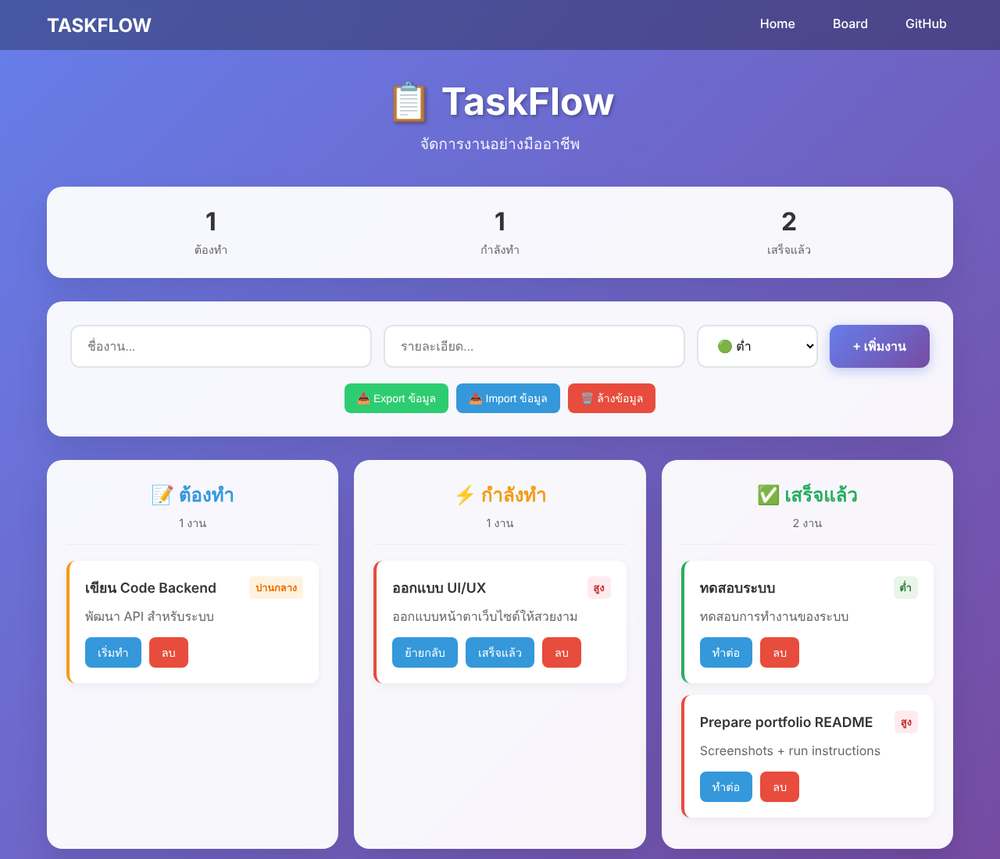

# 📋 TaskFlow — Kanban Board in Vanilla JavaScript

**A three-column Kanban board (To do → In progress → Done) that runs entirely in the browser. No framework, no build step, no backend. Tasks persist in `localStorage` and can be exported and imported as JSON.**




## Features

- **Kanban workflow:** move cards with buttons or **drag and drop** between columns
- **Priorities:** low / medium / high, colour-coded on each card
- **Live counters** per column
- **Auto-save** to `localStorage`, so the board survives a page reload
- **Backup and restore:** export the board to a dated JSON file and import it again; imported files are validated (unknown statuses or priorities are normalised, malformed entries dropped)
- **Safe rendering:** task text is HTML-escaped before it is rendered, so input like `` shows as plain text instead of running

## Run it

No install needed:

```bash
git clone https://github.com/tawan230666/TASKFLOW.git
cd TASKFLOW
open index.html          # or double-click it / serve with any static server
```

## Project structure

```
index.html       Markup only
css/style.css    Layout, card styles, animations, drag-and-drop states
js/script.js     State, rendering, persistence, drag and drop, import/export
images/          Favicon
```

## How it works

All state is a single `tasks` array. Every mutation (`addTask`, `moveTask`, `deleteTask`, import) ends in `refresh()`, which saves to `localStorage`, re-renders the three columns and updates the counters. This one-way flow keeps the UI and storage from drifting apart.

## Next steps

- Edit a task in place
- Due dates and filtering
- Sync across devices with a small REST backend

---

**Author:** Tawan Tiphkun (ธาวัน ทิพคุณ), [@tawan230666](https://github.com/tawan230666), Software Engineering, RMUTL Chiang Mai
